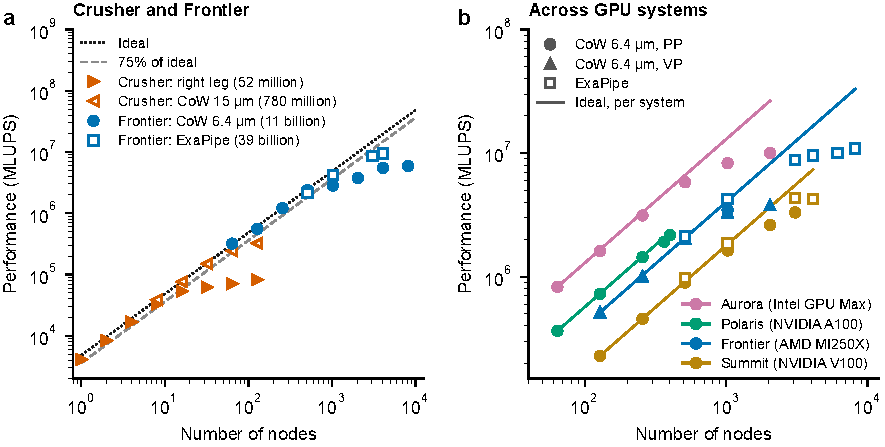

# HemePure_GPU
**GPU version of HemePure**  <br />



This repository represents a porting of the CPU-only [HemePure](https://github.com/UCL-CCS/HemePure) version of the HemeLB code to enable execution of GPUs. This version on the default branch (HIP-CUDA-ROCM_SL) is able to run on both Nvidia and AMD hardware and has demonstrated strong scaling to tens of thousands of GPU cards on both vendors' hardware. It is available under the BSD-3-Clause license. Development of this version from the HemePure code began in 2019, the major developer of this implementation has been Ioannis Zacharoudiou (UCL). Balint Joo (ORNL/Nvidia) has also provided significant support in enabling execution on differing hardware. The HIP-CUDA-ROCM-SYCL-Functor branch uses functors to allow compilation and execution on Nvidia, AMD and Intel GPU hardware - refer to that branch for specific compilation instrutions.

Pre- and post-processing of simulation domains for HemePure-GPU follow the same steps as utilised by the CPU version.


If you use HemePure_GPU in your research, please cite:

```bibtex
@misc{xue2026exascale,
  title={Exascale-ready HemeLB for large-eddy simulation of full-human arterial blood flow},
  author={Xue, Xiao and Zacharoudiou, Ioannis and Coveney, Peter V},
  year={2026},
  eprint={2611.07840},
  archivePrefix={arXiv},
  primaryClass={physics.flu-dyn},
  url={https://arxiv.org/abs/2611.07840}
}

@article{zacharoudiou2023hemelb,
  title={Development and performance of a HemeLB GPU code for human-scale blood flow simulation},
  author={Zacharoudiou, Ioannis and McCullough, Jon WS and Coveney, Peter V},
  journal={Computer Physics Communications},
  volume={282},
  pages={108548},
  year={2023},
  publisher={Elsevier}
}
```

Contributed papers:

```bibtex
@article{xue2026uncertainty,
  title={An uncertainty visualization framework for large-scale cardiovascular flow simulations: A case study on aortic stenosis},
  author={Xue, Xiao and Athawale, Tushar M and McCullough, Jon WS and Lo, Sharp CY and Zacharoudiou, Ioannis and Jo{\'o}, B{\'a}lint and Georgiadou, Antigoni and Coveney, Peter V},
  journal={Journal of Computational Science},
  volume={99},
  pages={102914},
  year={2026},
  publisher={Elsevier}
}

@inproceedings{xue2024lattice,
  title={The lattice Boltzmann based large eddy simulations for the stenosis of the aorta},
  author={Xue, Xiao and McCullough, Jon WS and Lo, Sharp CY and Zacharoudiou, Ioannis and Jo{\'o}, B{\'a}lint and Coveney, Peter V},
  booktitle={Computational Science -- ICCS 2024},
  pages={408--420},
  year={2024},
  publisher={Springer Nature Switzerland}
}
```

##  Features #
The GPU version of HemePure can be executed with the following functionality. Some must be specified at the compilation of the hemepure executable. Simulations are conducted using a D3Q19 lattice stencil.

Collision kernels (compile time):
* LBGK - Single relaxation time
* LBGK + LES - Inclusion of large eddy simulation approximation to assist in higher Re flow modelling.

Inlet/Outlet boundary conditions (compile time):
* Pressure
  - Sinusoidal profile (constant pressure enabled using)
  - Transient profile
  - Sponge layer (outlets) - Acts on a pressure outlet but modifies the viscosity near the outlet to increase stability of the simulation (defined with collision kernel).
* Velocity
  - Constant magnitude with parabolic profile for circular inlets
  - Transient profile with parabolic profile for circular inlets
  - Transient profile with Poiseuille-like profile for non-circular inlets

Wall boundary conditions (compile time):
 * Bounceback - simple rigid walls
   
Data output (run time):
* Extraction of data from the following locations in a domain:
  - Point on surface
  - Line between two points
  - Plane through the domain
  - Inlets
  - Outlets
  - Wall surface
  - Whole domain
* Checkpoint restart from written data file

## Compilation #
As per the CPU version of the code, the dependencies need to be built before attempting to compile the source code and `hemepure_gpu` executable.

### DEPENDENCIES #
1) Create `dep/build/` .
2) In `dep/build/` run `ccmake -B. -H../` or `ccmake ..` .
3) Configure using CMake.
4) Run `make` in `dep/build/`.

### SOURCE #
1) Create `src/build/`.
2) In `src/build/` run `ccmake -B. -H../` or `ccmake ..` .
3) Configure using CMake.
4) Run `make` in `src/build/`.

The choice of Boudary conditions at the inlets and outlets should be also be taken into account when compiling the ssource code. 
There are two different options for driving the blood flow. 
1) Case Pressure-Pressure BCs: 

From `src/build/` run the following

```sh
cmake  -DHEMELB_USE_VELOCITY_WEIGHTS_FILE=OFF \
       -DHEMELB_INLET_BOUNDARY=NASHZEROTHORDERPRESSUREIOLET \
       -DHEMELB_WALL_INLET_BOUNDARY=NASHZEROTHORDERPRESSURESBB \
       -DHEMELB_OUTLET_BOUNDARY=NASHZEROTHORDERPRESSUREIOLET \
       -DHEMELB_WALL_OUTLET_BOUNDARY=NASHZEROTHORDERPRESSURESBB \
       ..
```

2) Case of Velocity-Pressure BCs: 
   
From `src/build/` run the following

```sh
cmake  -DHEMELB_USE_VELOCITY_WEIGHTS_FILE=ON \
       -DHEMELB_INLET_BOUNDARY=LADDIOLET \
       -DHEMELB_WALL_INLET_BOUNDARY=LADDIOLETSBB \
       -DHEMELB_OUTLET_BOUNDARY=NASHZEROTHORDERPRESSUREIOLET \
       -DHEMELB_WALL_OUTLET_BOUNDARY=NASHZEROTHORDERPRESSURESBB \
       ..
```

### Compilation for different GPU backend

You can select different GPU backends (CUDA, HIP-CUDA, HIP-ROCM) with the
`HEMELB_GPU_BACKEND` option.

#### CUDA

```sh
mkdir src/build && cd src/build
cmake -DHEMELB_GPU_BACKEND=CUDA ..
make -j
```

#### HIP-CUDA

```sh
export CUDA_PATH=/path/to/cuda/installation
export HIP_PATH=/path/to/hip/installation
export HIP_PLATFORM=nvidia HIP_COMPILER=nvcc HIP_RUNTIME=cuda
mkdir src/build && cd src/build
cmake -DHEMELB_GPU_BACKEND=HIP_CUDA ..
make -j
```

#### HIP-ROCM

```sh
export HIP_PATH=/path/to/hip/installation
export HIP_PLATFORM=amd HIP_COMPILER=clang HIP_RUNTIME=rocclr
mkdir src/build && cd src/build
cmake -DHEMELB_GPU_BACKEND=HIP_ROCM -DCMAKE_CXX_COMPILER=hipcc ..
make -j
```

You may also want to set `CMAKE_PREFIX_PATH` to directories containing cmake
modules for `AMDDeviceLibs`, `amd_comgr` and `hsa-runtime64` if they are not in
standard HIP location.

When cross-compiling you may want to set `HCC_AMDGPU_TARGET` to specify which
architecture you want to compile for:

```sh
export HCC_AMDGPU_TARGET="gfx906,gfx908,gfx90a"
```
